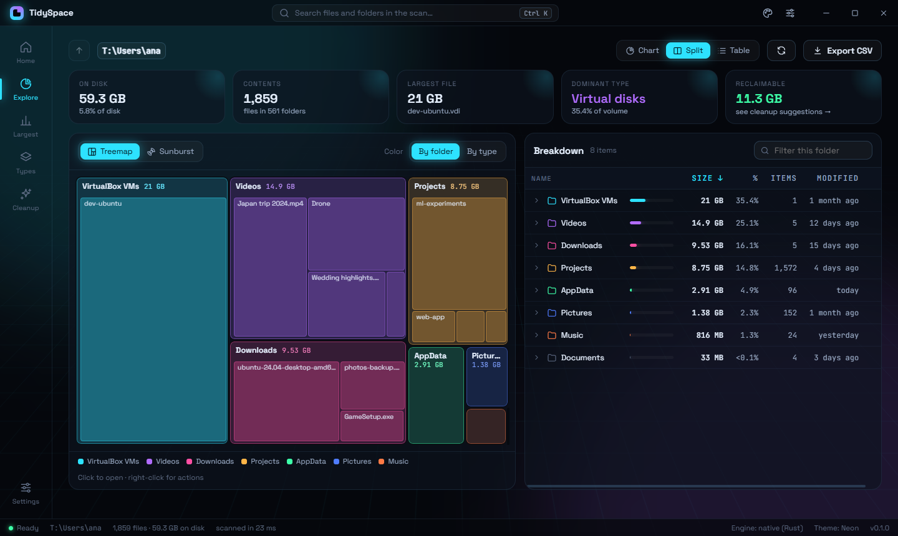
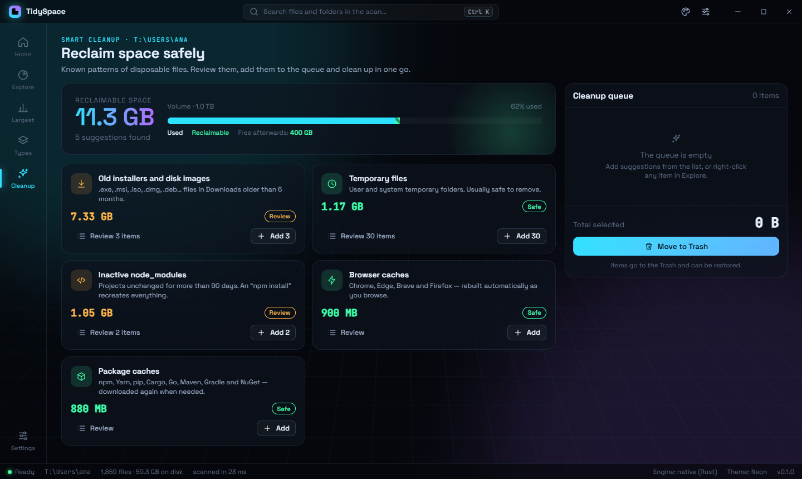
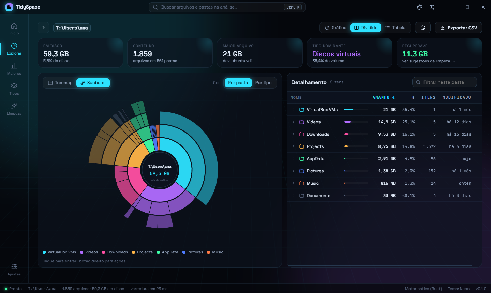

# TidySpace

Find out what is taking up space on your disk — a whole drive or a single folder — with
graphical (treemap and sunburst) and analytical (tree table) views, cleanup suggestions and safe
removal. Runs on **Windows, macOS and Linux**, in **English and Portuguese**.



| Smart cleanup                                                                      | Sunburst (Portuguese UI)                                                       |
| ---------------------------------------------------------------------------------- | ------------------------------------------------------------------------------ |
|  |  |

## Features

- **Fast, parallel scanning** in Rust, with a TypeScript fallback; a whole drive or just one folder.
- **Real on-disk size**: cloud-only files (OneDrive, iCloud, Dropbox) count as 0, and sparse or
  compressed files count what they actually occupy. Hard links (pnpm, WinSxS) are counted once.
- **Treemap, sunburst and table** views you can drill into, colored by folder or by file type.
- **Cleanup suggestions** (temp files, caches, stale `node_modules`, old installers…) sized by
  what would really be freed.
- **Safe removal**: Trash by default, permission check before removing, protected system folders,
  and permanent deletion only when enabled.
- **Saved scans** in a local SQLite database, reopened without rescanning.
- **English and Portuguese**: follows the system language (English for any other language) and
  can be changed in Settings; four visual themes.

## Getting started

Prerequisites (for Development):

|                              | All | Windows                                                                            | macOS                    | Linux             |
| ---------------------------- | --- | ---------------------------------------------------------------------------------- | ------------------------ | ----------------- |
| Node.js 22 (≥ 22.22.2) or 24 | ✔   |                                                                                    |                          |                   |
| Rust stable (`rustup`)       | ✔   | **MSVC** toolchain + Visual Studio Build Tools with “Desktop development with C++” | Xcode Command Line Tools | `build-essential` |

```bash
npm install
npm run build:native   # builds the Rust scanner (src/native) → src/native/node/dist
npm run dev            # app with hot reload
```

Without the native module the app **still works**, using the slower TypeScript fallback scanner;
the status bar shows which engine is active.

### Choosing the engine at startup

The `--engine=` argument (or the `TIDYSPACE_ENGINE` environment variable) selects the scan engine:

| Value              | Behavior                                                                 |
| ------------------ | ------------------------------------------------------------------------ |
| `auto` (default)   | Rust; falls back to Node if the module can't be loaded                   |
| `native` or `rust` | Requires Rust: if the module can't be loaded, scans fail and explain why |
| `node`             | TypeScript only, nothing native (even when the module is available)      |

```bash
npm run dev:node                     # = npm run dev -- -- --engine=node
npm run dev:native
npm run preview -- -- --engine=node  # production build
TidySpace.exe --engine=node          # installed app
```

An invalid value is reported on the console and the app uses `auto`.

| Script                                | What it does                                                               |
| ------------------------------------- | -------------------------------------------------------------------------- |
| `npm run dev` / `npm run preview`     | Development with HMR / runs the production build                           |
| `npm run build`                       | Builds main, engine, preload and renderer into `out/`                      |
| `npm run build:native`                | Builds the Rust addon (release)                                            |
| `npm run check`                       | Lint + typecheck + unit tests                                              |
| `npm run test:coverage`               | Unit tests with coverage (Vitest)                                          |
| `npm run test:e2e`                    | E2E tests on the real app (Playwright + Electron) — needs `npm run build`  |
| `npm run test:native` / `lint:native` | `cargo test` / `rustfmt` + `clippy -D warnings`                            |
| `npm run screenshots`                 | Regenerates the README screenshots (Windows)                               |
| `npm run icons`                       | Regenerates the app icons (`build/`, `resources/`) from the title bar mark |
| `npm run package`                     | Builds the installer for the current OS into `release/`                    |

## Architecture

```
┌──────────────── renderer (React, sandboxed) ──────────────┐
│ screens · charts · stores (Zustand) · cached useQuery     │
└───────────────▲──────────────────────────────┬────────────┘
     window.tidyspace (preload, contextBridge) │ ids, never paths, for deletion
┌───────────────┴──────────── main ────────────▼────────────┐
│ validated IPC (zod) · FileActions + safety policy         │
│ settings (JSON) · window                                  │
└───────────────▲──────── typed RPC ───────────┬────────────┘
┌───────────────┴────── engine (utilityProcess) ▼───────────┐
│ Scanner (strategy): NativeScanner (Rust) | NodeScanner    │
│ TreeIndex (typed arrays) · suggestion rules · SQLite      │
└───────────────────────────────────────────────────────────┘
```

- **`src/native`** — Rust workspace: `core` (parallel walk with rayon, testable with plain
  `cargo test`) and `node` (thin N-API binding). Produces a columnar, pre-order _snapshot_: a
  parent always comes before its children and every subtree is a contiguous index range.
- **`src/engine`** — isolated process that owns the scans. Flow: scan → O(n) aggregation
  (`TreeIndex`) → suggestions → written to **SQLite** → memory is released and queries
  (hierarchical view, paged children, largest items, types, search) are served from the database
  through indexes. A crash here doesn't take the window down; main restarts the process.
- **`src/main`** — window, IPC, persistence and destructive actions.
- **`src/preload`** — minimal, typed bridge (`TidySpaceApi`) with no dependencies.
- **`src/renderer`** — the UI. Styles and themes in `styles/app.css`.
- **`src/shared`** — domain types, IPC contract, categories, settings, formatting and i18n.

### Performance per platform

The native scanner reads directories in parallel with _work stealing_. On Windows the directory
listing itself already includes sizes, with no extra call per file; on Linux/macOS there is one
`lstat`/`statx` per entry. On Linux the scan doesn't cross into other file systems (`/proc`,
`/sys`, mounts), like `du -x`.

Hard links are counted once. On Linux/macOS the link count comes for free with `stat`; on Windows
it costs one query per file, so it is only done where hard links actually show up — pnpm's
`node_modules/.pnpm`, the pnpm store and the Windows folder (WinSxS). It can be turned off in
Settings.

Future speedups, pluggable through the `Scanner` interface without changing the rest of the app:
reading the NTFS **MFT** (when running as administrator) and **`getattrlistbulk`** on macOS.

### On-disk vs. logical size

By default everything is measured by the **space actually used on disk**. Cloud-only files
(OneDrive/Dropbox "on demand", iCloud "optimize storage") count as 0 and show a cloud icon;
sparse/compressed files count what they really occupy. Detection: `RECALL_ON_*`/`OFFLINE`
attributes + `GetCompressedFileSizeW` (Windows), `SF_DATALESS` + blocks (macOS), `st_blocks`
(Linux). Settings can switch to the logical size. The Node fallback scanner can't see file
attributes on Windows — there, only the native engine identifies cloud files.

Cleanup sizes also discount hard-linked content: removing a pnpm project's `node_modules` frees
almost nothing while the pnpm store still links to the same files (`pnpm store prune` reclaims it).

## Local storage

Everything lives in `app.getPath('userData')` (`%APPDATA%\TidySpace`,
`~/Library/Application Support/TidySpace`, `~/.config/TidySpace`), using the SQLite built into
Electron (`node:sqlite`, no extra native module):

- `scans/<id>.db` — **one scan per file**: pre-order tree with aggregated totals, suggestions and
  a precomputed per-type breakdown. Written to `.part` and renamed at the end (never left
  half-written); indexes are created after the bulk load. Deleting a scan = deleting the file.
- `catalog.db` — list of saved scans. Keeps one per location (the latest) and the last _N_ overall
  (Settings › Saved scans). The latest one is reopened when the app starts.
- `settings.json` — validated with zod (an invalid file is renamed to `.corrupt-<date>` and the
  defaults come back), atomic writes and serialized read-modify-write.

Reference with 1 million entries: ~5 s to save (once, with a progress bar), Explore screens in
1–5 ms, largest items ~20 ms, search ~150 ms; ~95 MB database.

## Safety

- Renderer with `sandbox` and `contextIsolation`, no `nodeIntegration`; strict CSP in production;
  external navigation blocked; IPC only accepts the main window and validates every parameter.
- Deletions receive **ids** from the index — the path is resolved in the engine, never taken from
  the renderer.
- `checkDeletable` refuses volume roots, the user's home folder and its ancestors, and system
  trees (with safe exceptions such as `Temp`), for both Trash **and** permanent deletion.
- Before removing, each item is checked for permission **without elevation**: protected items are
  skipped with an explanation instead of triggering an admin prompt.
- Default: **move to Trash**. Permanent deletion only if enabled in Settings, with an extra
  confirmation.

## Tests

- **Unit (Vitest)**: tree index, suggestions per platform, scanners (on a real file system in a
  temp folder), RPC, persistence, safety policy, hard links, i18n catalogs, chart geometry and
  components (Testing Library).
- **Rust**: `cargo test` on `scanner-core` (pre-order, exclusions, cancellation, links, hard links,
  paths over 260 characters, permission and in-use checks).
- **E2E (Playwright)**: launches the real app on a real file system and covers leaving and
  returning to a running scan, completion notice, Explore, every context-menu action (system calls
  intercepted), saved scans and reopening after restart, Trash, protected folders, background
  cleanup with progress, pnpm `node_modules` (junctions, hard links, long paths), engine selection
  and switching languages. E2E runs with the Portuguese UI regardless of the OS language.

## Languages

Texts live in typed per-area catalogs in [`src/shared/i18n/messages`](src/shared/i18n/messages).
Portuguese is the reference and English must have the same keys (a test enforces it, and also
checks that no Portuguese text was left in the English catalog). To add a language, add it to
`LOCALES` ([`locale.ts`](src/shared/i18n/locale.ts)) and to every catalog.

Every process (UI, main and engine) uses the language chosen in Settings, or the system language
when the option is “Automatic”: Portuguese → pt-BR; anything else → English.

## Continuous integration and releases

GitHub Actions ([ci.yml](.github/workflows/ci.yml)) runs lint, types, unit and Rust tests on every
push to `main` and on pull requests; then it builds, runs the E2E suite and produces the
installers on each platform:

| Platform                      | Installer           | Runner                               |
| ----------------------------- | ------------------- | ------------------------------------ |
| Windows x64 / arm64           | `.exe` (NSIS)       | `windows-latest` / `windows-11-arm`  |
| Linux x64 / arm64             | `.AppImage`, `.deb` | `ubuntu-latest` / `ubuntu-24.04-arm` |
| macOS (Intel + Apple Silicon) | universal `.dmg`    | `macos-latest`                       |

Installers are kept as run artifacts (14 days). To publish a version:

```bash
npm version 0.2.0        # updates package.json and creates the v0.2.0 tag
git push --follow-tags   # CI publishes the installers to Releases
```

The tag must match the `package.json` version; tags with a suffix (`v0.3.0-beta.1`) are published
as pre-releases. Installers are **not signed** yet: on Windows, SmartScreen warns about an
“unknown publisher”; on macOS, if you see “the app is damaged”, run
`xattr -cr /Applications/TidySpace.app`.

## Troubleshooting

- **`SyntaxError: ... 'electron' does not provide an export named 'BrowserWindow'`** — the
  `ELECTRON_RUN_AS_NODE` variable is set (the VS Code terminal does that). The `dev`/`preview`
  scripts already remove it; if you run Electron by hand, unset it first.
- **Status bar shows “Engine: Node (fallback)”** — the addon wasn't built for this platform; run
  `npm run build:native` (on Windows, with the Visual Studio Build Tools).
- **macOS**: to scan protected folders (e.g. Mail, Photos), grant TidySpace _Full Disk Access_ in
  System Settings › Privacy & Security.

## Disclaimer

TidySpace moves files to the Trash and, if you enable it, deletes them permanently. It is provided
**"as is", without warranty of any kind**: review what you remove, and keep backups of anything
important. The authors are not liable for any data loss or other damage arising from its use (see
the [license](LICENSE)).

## License

[MIT](LICENSE) © 2026 Working Minds
